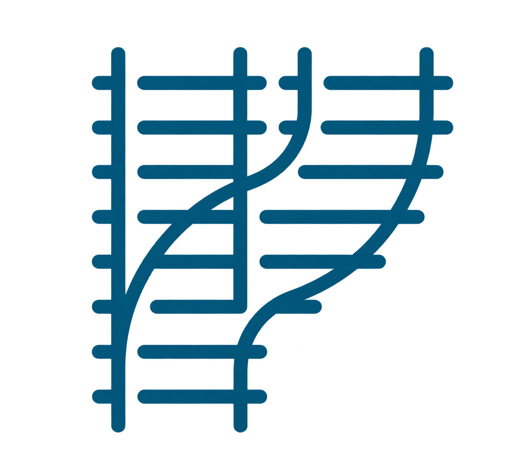

<p align="center">
  
</p>

<h1 align="center">turnout</h1>

<p align="center"><strong>Plan your railway. Piece by piece.</strong></p>

<p align="center">
  <a href="#install">Install</a> ·
  <a href="#use">Use</a> ·
  <a href="docs/GUIDE.md">Guide</a> ·
  <a href="docs/ROADMAP.md">Roadmap</a>
</p>

---

Turnout connects your AI assistant to model railway planning. It is a local
[Model Context Protocol (MCP)](https://modelcontextprotocol.io/) server for
**Märklin C-track layouts in XTrackCAD**: describe what you want, let Python
handle the geometry, then review the result in your drawing editor.

## What it does

- **Explore your track.** Search the catalogue for track pieces, including
  their geometry, paths and connection points.
- **Understand a layout.** Inspect an existing `.xtc` file, count its pieces,
  identify open ends and connection issues, and see a labelled SVG preview.
- **Extend existing track.** Attach a catalogue piece to an open endpoint,
  including turnouts and buffer stops, and save a separate revision with a preview.
- **Build a closed oval.** Generate a layout from real catalogue pieces, with
  checks for closure, board fit and centreline intersections.

XTrackCAD remains your editor for detailed changes, printing and train operation.
Turnout works with local files and writes generated layouts separately. It does
not call a model or require an API key; you bring your own MCP-compatible AI client.

Closed-loop generation supports ordinary straights and curves. Connected extension
supports all 43 pieces in the bundled catalogue, one piece at a time, using one
track system per layout. Roadbed and vehicle clearance are outside the current
scope; XTrackCAD open/save verification for connected extension remains pending.
See the [guide](docs/GUIDE.md) for limits and the [roadmap](docs/ROADMAP.md) for plans.

## Install

You need **Python 3.13+**, [uv](https://docs.astral.sh/uv/getting-started/installation/),
an MCP-compatible AI client, and XTrackCAD to open and review layouts.
The commands below use a macOS or Linux shell.

```sh
git clone https://github.com/guimarais/turnout.git
cd turnout
uv sync --locked
```

Keep this checkout in place: Turnout uses the catalogue and example files here.
Installation currently runs from source.

For Codex, run these commands from the repository root with the Codex CLI installed:

```sh
codex mcp add turnout -- "$PWD/.venv/bin/python" -m turnout
codex mcp get turnout
```

Open a new chat or restart the client if the tools are not visible. Other clients
can launch the same stdio server; see the [connection guide](docs/GUIDE.md#installation-and-connection-options)
for the launch command and configuration example.

## Use

Start by asking your connected AI assistant to inspect the supplied layout:

> Use turnout to inspect `examples/mrkln_sample.xtc`. Show the labelled preview,
> list its open endpoints, and explain any connection issues.

To extend it:

> Use turnout to attach a Märklin 24188 straight to open endpoint `4:2` in
> `examples/mrkln_sample.xtc`. Save a separate revision and show its preview.

Or try generating a layout:

> Use turnout to make a closed oval on a 2000 × 1200 mm board. Use six Märklin
> 24130 curves, one 24188 straight, six more 24130 curves, then another 24188
> straight. Return the file path and parts list.

Open the returned `.xtc` file in XTrackCAD and review its geometry and connections.
Save any manual changes as a separate file and use that file for the next inspection.
Generated layouts go into `layouts/`; previews go into `previews/`.

For tool arguments, supported file records, geometry limits and compatibility
checks, read the **[Turnout guide](docs/GUIDE.md)**.

---

[Contributing](CONTRIBUTING.md) · [Roadmap](docs/ROADMAP.md) · [GPL-3.0 license](LICENSE)
